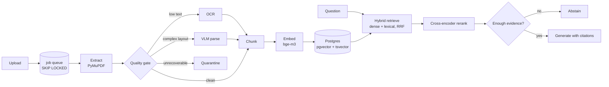

# sift

**A document ingestion and retrieval system that validates what it actually extracted, defends itself against malicious uploads, and tunes its own retrieval strategy for a corpus it has never seen.**

> **Status: work in progress.** Milestone 1 of 3. Not production ready, not feature complete, and the
> benchmark tables below are unpopulated until the evaluation harness lands in Phase 5. See
> [Current status](#current-status).

---

## Why this exists

Most "chat with your PDFs" projects share three assumptions, and all three are wrong outside a demo:

1. **That text extraction worked.** PDF parsers almost never raise an exception. They return
   *something* — interleaved columns from a two-column layout, an empty string from a scanned page,
   a run-on sentence where a table used to be. The user gets confident, wrong answers and never
   learns why.
2. **That one retrieval configuration fits every corpus.** Chunk size, dense vs. hybrid search, and
   reranking all have corpus-dependent optima. `chunk_size=1000` is a guess that nobody measures.
3. **That uploaded documents are trustworthy.** A PDF containing white-on-white 1pt text reading
   *"ignore previous instructions"* is trivial to build and works against a naive pipeline.

`sift` treats all three as first-class engineering problems rather than edge cases.

**Design thesis:** RAG is a search engine with a text generator stapled to the end. Most RAG failures
are search failures. So the measurement harness is built *before* the optimizations, and every
retrieval feature has to justify itself against a recorded baseline.

---

## The three pillars

### 1. Extraction quality gate

Every page is scored on named signals — text density, dictionary-word ratio, column-interleave
suspicion, table density, repeated header/footer detection — before anything is indexed. Low-text
pages route to OCR, complex layouts route to a vision-model parser, and unrecoverable documents are
**quarantined rather than silently indexed**.

The result is surfaced to the user instead of hidden:

```
contract_2019.pdf   scanned document, OCR applied, extraction confidence 0.71
q3_report.pdf       14 tables detected, extracted as structured rows
blueprint.pdf       no recoverable text — excluded from the index
```

### 2. Self-tuning retrieval

You cannot hand-tune chunking for a corpus you have never seen. So the system:

1. generates a grounded evaluation set from the user's own documents, including a deliberately
   **unanswerable** slice;
2. runs an ablation across retrieval configurations — chunk sizes, dense / lexical / hybrid,
   reranking on and off, varying `top_k`;
3. selects and persists the winning configuration for that corpus, and shows the user the table.

### 3. Document-borne prompt injection defense

Uploaded files are untrusted input that ends up inside an LLM context window. `sift` detects
invisible and off-canvas text using font and colour data captured at extraction time, structurally
isolates retrieved content from instructions, enforces per-upload resource limits, and ships an
adversarial PDF corpus that runs in CI.

---

## Architecture



Three data planes, deliberately separated:

| Plane | Trigger | Runtime | Workload |
|---|---|---|---|
| Interactive | User upload | Postgres `SKIP LOCKED` worker | Extract, gate, chunk, embed, index |
| Batch | Schedule / manual | Airflow | Corpus re-embedding on chunk-strategy change, nightly eval, retention |
| Analytics | Post-hoc | dbt | Staging and marts over ingest events, quality signals, eval results |

Per-upload work is event-driven and stays out of the scheduler. Airflow only owns jobs that operate
on the whole corpus at once — the ones that need retries, backfills, and resumability.

---

## Current status

Milestone 1 is the publishable core; Milestones 2 and 3 follow.

**Milestone 1 — core system**

- [x] Phase 0 — Foundations: Postgres + pgvector, Ollama, embedding probe
- [ ] Phase 1 — Data model: content hashing, document versioning, Alembic migrations
- [ ] Phase 2 — Extraction + quality gate (Pillar 1)
- [ ] Phase 3 — Baseline RAG (deliberately naive, exists to be beaten)
- [ ] Phase 4 — Evaluation harness + corpus-generated golden set (Pillar 2a)
- [ ] Phase 5 — Hybrid retrieval, reranking, ablation, auto-tune (Pillar 2b)
- [ ] Phase 6 — Injection defense + red-team suite (Pillar 3)

**Milestone 2 — data platform**

- [ ] Phase 7 — Async ingestion worker, resumability, batch upload
- [ ] Phase 8 — Airflow: re-embedding backfill DAG, nightly eval DAG, retention DAG
- [ ] Phase 9 — dbt: staging models, marts, SCD2 snapshots on document versions

**Milestone 3 — production polish**

- [ ] Phase 10 — Provable deletion, version supersession, tenant isolation
- [ ] Phase 11 — Langfuse tracing, Docker profiles, CI eval gate, model benchmarks
- [ ] Phase 12 — Hard-PDF extraction benchmark, write-ups

---

## Results

> Unpopulated until Phase 5. Numbers will be added only when reproducible via the commands shown.
> Nothing here is an estimate.

### Retrieval ablation

| Configuration | Context recall | Faithfulness | Answer relevancy | Correct abstention | p95 latency |
|---|---|---|---|---|---|
| Dense only, fixed 1000-char chunks (baseline) | TBD | TBD | TBD | TBD | TBD |
| + hybrid lexical (RRF) | TBD | TBD | TBD | TBD | TBD |
| + cross-encoder rerank | TBD | TBD | TBD | TBD | TBD |
| + contextual retrieval | TBD | TBD | TBD | TBD | TBD |
| + tuned chunk size | TBD | TBD | TBD | TBD | TBD |

Reproduce with `make eval`.

### Extraction quality benchmark

Measured against a hand-labelled corpus of deliberately difficult public-domain PDFs — scanned,
two-column, table-heavy, rotated, hyphenated, CJK.

| Parser | Clean text | Two-column | Tables | Scanned | Overall |
|---|---|---|---|---|---|
| pypdf | TBD | TBD | TBD | TBD | TBD |
| pdfplumber | TBD | TBD | TBD | TBD | TBD |
| PyMuPDF | TBD | TBD | TBD | TBD | TBD |
| `sift` (routed) | TBD | TBD | TBD | TBD | TBD |

### Adversarial suite

| Attack class | Caught |
|---|---|
| Invisible text injection | TBD |
| Off-canvas text injection | TBD |
| Resource exhaustion (page/expansion bombs) | TBD |

---

## Quickstart

Requires Docker and, for the `dev` profile, [Ollama](https://ollama.com) running natively.

```bash
git clone https://github.com/<you>/sift && cd sift
cp .env.example .env          # set POSTGRES_PASSWORD
ollama pull qwen2.5:7b-instruct
docker compose -f docker/compose.yaml up -d
uv sync
make migrate
make dev
```

First run downloads the `bge-m3` embedding model (~2.3GB) from HuggingFace. This is not a hang.

### Two profiles, and why

Docker Desktop on Apple Silicon does not pass the Metal GPU through to containers, so containerised
inference falls back to CPU and is roughly an order of magnitude slower.

| Profile | Models | Services | Use for |
|---|---|---|---|
| `dev` | Host (Metal-accelerated) | Containerised | Daily development |
| `portable` | Containerised (CPU) | Containerised | One-command reproduction on any machine |

Rather than pretend this tradeoff doesn't exist, both are supported and documented.

---

## Stack

| Layer | Choice | Rationale |
|---|---|---|
| Datastore | Postgres 16 + pgvector | One store for documents, chunks, vectors, jobs, and analytics. Makes deletion transactional and therefore provable. |
| Lexical search | Postgres `tsvector` + `ts_rank_cd` | Hybrid retrieval in a single SQL query, no second system |
| Embeddings | `bge-m3` via sentence-transformers (MPS) | 1024-dim, 8192-token context, symmetric (no task prefixes), and its sparse + ColBERT outputs give extra ablation arms for free |
| Reranking | `bge-reranker-v2-m3` cross-encoder | Largest single measurable quality gain in retrieval |
| Generation | `qwen2.5:7b-instruct` via Ollama | Strong grounding discipline; local-only, no API keys |
| Extraction | PyMuPDF, pdfplumber, ocrmypdf | PyMuPDF exposes coordinates, font size and colour — required for both the quality gate and invisible-text detection |
| Queue | Postgres `FOR UPDATE SKIP LOCKED` | Exactly-once-ish semantics with zero extra infrastructure |
| Orchestration | Airflow 3 | Batch plane only |
| Transformation | dbt-core + dbt-postgres | Analytics over operational telemetry |
| API / UI | FastAPI + thin Streamlit | The UI is the demo surface, not the product |
| Evaluation | RAGAS + custom abstention metrics | Standard vocabulary plus the metrics RAGAS lacks |

**Deliberately rejected:** a dedicated vector database (a second datastore makes deletes
non-transactional with your metadata); Celery and Redis (three services for a single-node app);
end-to-end LangChain RAG chains (they hide precisely the logic this project exists to demonstrate —
LangChain is confined to the generation layer).

---

## Design notes

Longer write-ups live in [`docs/`](docs/).

- **Why evaluation comes before optimization.** You cannot claim a retrieval improvement without a
  recorded baseline. Phase 3 ships a deliberately naive pipeline so Phases 5 onward have something
  to beat.
- **Why quarantine beats silent indexing.** A document that extracted badly is worse than a missing
  document, because it produces confident wrong answers instead of an honest "not found".
- **Why abstention is a measured metric.** The unanswerable slice of the eval set is more
  informative than the answerable slice.
- **Why a chunking change forces a full re-embed.** Chunk boundaries determine vector content, so
  Phase 5's auto-tuner triggers a corpus-wide backfill — the reason the Airflow plane exists.

---

## Non-goals

Authentication and SSO, chat history and memory, autonomous agents, cloud deployment, non-PDF
formats, model fine-tuning, GraphRAG.

---

## License

MIT